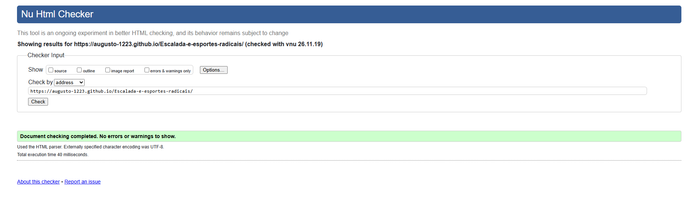

# Escalada e Esportes Radicais — Atividade 1 (HTML Semântico)

Tema: 38 Escalada e Esportes Radicais

## O que foi feito na Atividade 1
- Divisão semântica da página com header, nav, main, aside e footer
- Três cards em article contendo figure e figcaption, com imagens (alt, width e height)
- Grade de dados com caption, thead, tbody e th scope
- Seção de envio de mensagem com fieldset, legend, label e entradas tipadas
- Marcações de time, address, strong e em, mais atalho "Pular para o conteúdo"   
- CSS externo simples e responsivo   

## Validação W3C

